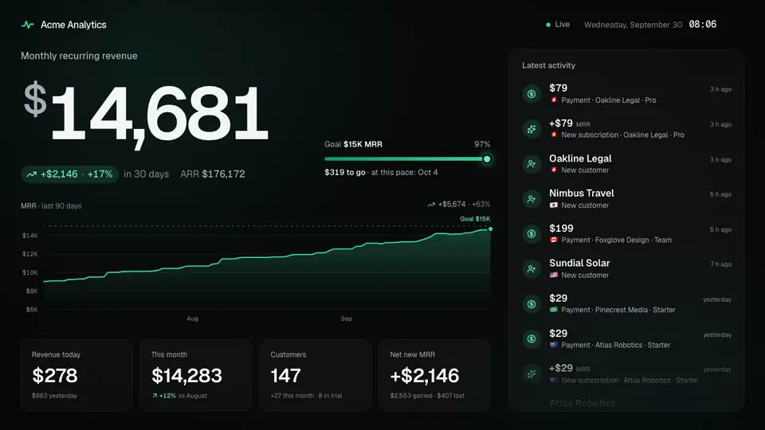
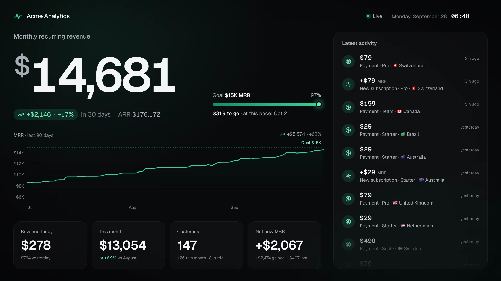
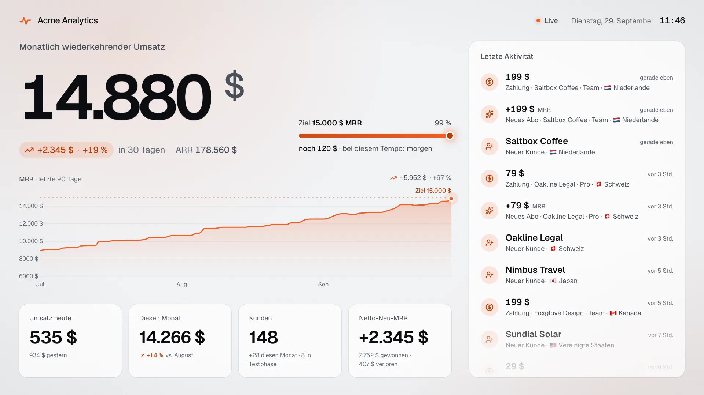
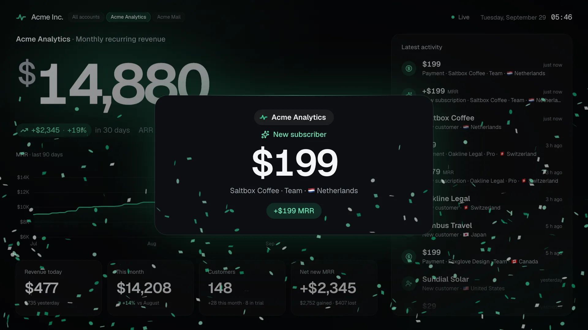
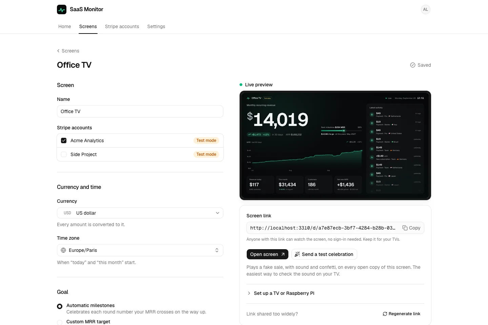
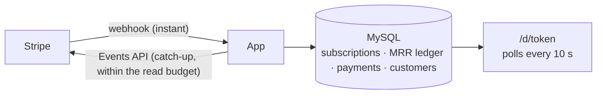

<div align="center">


# SaaS Monitor

**Watch your SaaS grow, live.**

Open-source Stripe dashboard for your office TV: hear every sale, and watch your MRR climb where
the whole team can see it.

[Live demo](https://saas-monitor.com/d/demo) · [Use it online](https://saas-monitor.com) · [Self-host](docs/self-hosting.md) · [Connect Stripe](docs/stripe.md) · [Put it on a TV](docs/wall-display.md)

[](https://github.com/Synapsr/SaaS-Monitor/actions/workflows/ci.yml)
[](https://github.com/Synapsr/SaaS-Monitor/releases/latest)
[](LICENSE)

<br />



**Try it in 10 seconds:** open the [live demo](https://saas-monitor.com/d/demo) and click once
for sound.

</div>

## Why

Building a SaaS is a long game, and the numbers that keep you going are buried in a dashboard
you rarely open. SaaS Monitor turns your Stripe account into a TV dashboard for the office, your
desk or a Raspberry Pi behind a screen: the MRR ticks up when a customer subscribes, a cash
register rings when a payment lands, a voice says "New subscriber!", and confetti flies when you
cross $10K MRR.

<table>
  <tr>
    <td colspan="2"></td>
  </tr>
  <tr>
    <td width="50%"></td>
    <td width="50%"></td>
  </tr>
</table>

## Features

- **Hear every sale**: payments, new customers, MRR up, MRR down and milestones each have their
  sound, in three packs (cash register, chime, arcade) synthesized in the browser.
  [Listen to them](https://saas-monitor.com/stripe-notification-sound).
- **A voice that announces them**: "New subscriber!", "Payment received!", in English, French,
  German, Spanish or Portuguese. With a [Gradium](https://gradium.ai) key, in your own words,
  with the customer's name, the amount and the plan.
- **Seven languages**: a screen speaks English, French, German, Spanish, Italian, Portuguese or
  Dutch, with numbers and dates written the local way.
- **Made for the wall**: runs in any browser, and best on a Raspberry Pi behind a TV,
  [set up with one block of commands](docs/wall-display.md#raspberry-pi-recommended). Scales from
  a 720p monitor to a 4K TV and portrait screens, never sleeps, recovers from network outages,
  reloads itself after an update, protects OLED panels.
- **Live metrics**: MRR, or ARR if that's how you count, with its 30-day growth; revenue today and
  this month, customers, net new MRR, and a feed of every new customer, payment, upgrade and churn.
- **A history chart** over the last 30 days, 90 days, 12 months or all time, with your next goal on
  its horizon.
- **Celebrations and goals**: confetti, a full-screen moment for each milestone ($1K, $10K MRR…,
  $1M ARR) or your own goal, with the date you'll reach it at your current pace.
- **Every event your way**: for each kind of event, choose whether it is listed in the feed, shown
  as a card, heard and said out loud.
- **Yours**: a dark or a light screen, in your brand color (pasted as hex, adjusted if needed to
  stay readable).
- **Dead simple settings** with a live preview, and a "send a test celebration" button to check
  the sound on the TV.
- **Several Stripe accounts** on one screen, converted to your currency: added up, or taking turns
  every few seconds, each moment naming the product it comes from. Or one screen per product.
- **Teams**: workspaces, invitations by link, as many screens as you like.
- **Honest numbers**: MRR is computed [as Stripe defines it](docs/stripe.md#how-mrr-is-computed),
  so the TV stays close to your Stripe Dashboard; the few known differences are documented.
- **Private and secure**: read-only restricted keys encrypted at rest, unguessable screen links
  with an optional password, customer names and emails hidden unless you allow them.
- **Real time within Stripe's limits**: webhooks for instant updates, and polling that respects
  Stripe's API read allowance when webhooks aren't available.

## Try it

- **Live demo**: <https://saas-monitor.com/d/demo> is a screen fed by a simulated SaaS, where
  something happens every 20 seconds or so. No account needed. Add
  [`?theme=light&lang=fr&accent=ff6b35`](https://saas-monitor.com/d/demo?theme=light&lang=fr&accent=ff6b35)
  for a light screen in French and your color,
  [`?accounts=2`](https://saas-monitor.com/d/demo?accounts=2) for two products taking turns, or
  `?sound=arcade&voice=sterling&range=all&metric=arr` for other settings.
- **Online**: create an account on <https://saas-monitor.com>, free during the public beta,
  connect Stripe with a read-only key, and open your screen's link on any TV. Updates are
  instant.
- **On your own server**: free for good, see [Self-hosting](#self-hosting). The demo is at
  `/d/demo` there too.

## How it compares

SaaS Monitor doesn't replace your analytics: it puts the numbers you already track where you
feel them. Keep Baremetrics or ChartMogul for the board deck, and put SaaS Monitor on the wall.

|                            | SaaS Monitor                                              | Stripe Dashboard                                    | Baremetrics, ChartMogul                                                                       | Geckoboard                                     |
| -------------------------- | --------------------------------------------------------- | --------------------------------------------------- | --------------------------------------------------------------------------------------------- | ---------------------------------------------- |
| Made for                   | A screen that stays on, in the room                       | Running your Stripe account, with billing analytics | Subscription analytics across billing systems                                                 | TV dashboards from 90+ data sources            |
| On a TV                    | Any number of screens, any browser, a Raspberry Pi        | —                                                   | —                                                                                             | 1 TV screen included, $20 per extra one        |
| Celebrations               | Sound, voice and confetti for Stripe sales and milestones | Push notifications in the mobile app                | —                                                                                             | Full-screen celebrations for won HubSpot deals |
| Price                      | Free: MIT, self-hosted, or hosted during the beta         | Included with Stripe Billing                        | Baremetrics priced by the ARR it tracks; ChartMogul free up to $120K ARR, then from $69/month | From $79/month, billed yearly                  |
| Open source, self-hostable | Yes                                                       | No                                                  | No                                                                                            | No                                             |

Checked on each product's own pages on 2026-09-30. Side-by-side comparisons:
[saas-monitor.com/alternatives](https://saas-monitor.com/alternatives). Product names are
trademarks of their owners; SaaS Monitor is not affiliated with them.

## Self-hosting

SaaS Monitor is a Next.js app and a MySQL database. With Docker, on a server or a Raspberry Pi
(the image is built for amd64 and arm64):

```bash
curl -fsSL https://saas-monitor.com/install.sh | sh
cd saas-monitor && docker compose up -d        # http://localhost:3000
```

The [script](public/install.sh) writes `compose.yaml` and a `.env` with fresh secrets, and starts
nothing on its own; the [self-hosting guide](docs/self-hosting.md) gives the same steps by hand.
Create your account, connect Stripe with a restricted key, and open your screen's link on any TV
or Raspberry Pi. The guide also covers building from source, HTTPS (needed for instant updates),
updates and backups.



## How it works



1. **Import**: subscriptions and 12 months of payments are imported once, in resumable chunks.
2. **Sync**: new activity is read from Stripe's Events API when a webhook announces it, or at a
   pace derived from your read allowance. Every change of MRR is recorded in a ledger, which gives
   the history chart and the new / expansion / contraction / churn breakdown.
3. **Display**: screens poll the app every 10 seconds; syncs run on demand, so no background
   worker is needed and the app runs anywhere Node runs.

More in [Connect Stripe](docs/stripe.md) and [Put it on a TV](docs/wall-display.md).

## Show us your wall

Put SaaS Monitor on a TV? Share a photo of it in
[Discussions](https://github.com/Synapsr/SaaS-Monitor/discussions): we'd love to see where it
lives.

If it's on your wall, a [star](https://github.com/Synapsr/SaaS-Monitor/stargazers) helps the next
founder find it.

## Development

Requirements: Node 24, pnpm 10 and Docker.

```bash
pnpm install
node scripts/setup.mjs   # .env with fresh secrets
pnpm db:up               # MySQL + stripe-mock
pnpm dev                 # http://localhost:3000
```

```bash
pnpm format:check && pnpm lint && pnpm typecheck && pnpm test && pnpm build   # what CI runs
```

Built with Next.js 16, React 19, Tailwind CSS 4, shadcn/ui, Drizzle ORM, MySQL, Better Auth
and the Stripe SDK. Read [CONTRIBUTING.md](CONTRIBUTING.md) and [AGENTS.md](AGENTS.md) for the
architecture and conventions.

## License

[MIT](LICENSE)
